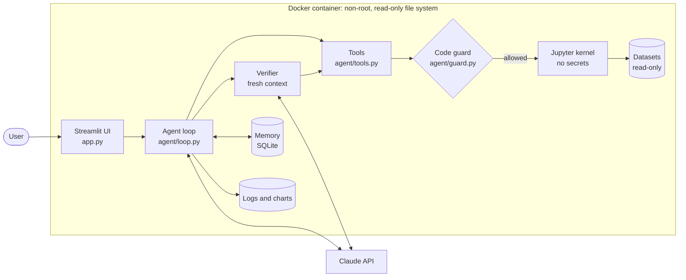

# data-agent

An AI data analyst: upload a CSV or Excel file, ask a question in plain language, and
the agent explores the data, writes and runs pandas code, checks its own numbers and
answers with the evidence.

<!-- TODO (author): record the demo and add docs/demo.gif -->


## Why not just upload the file to a chatbot?

- **Numbers are checked by code, independently.** A second model run with a fresh
  context recomputes every claim of the answer; contradicted claims go back to the
  agent to fix.
- **Every step is visible.** The plan, the code, its output and the charts are shown
  as they happen, and every run is logged as JSON.
- **Accuracy is measured, not assumed.** 39 eval questions with traps, expected
  values computed twice by independent code, results on held-out and final datasets
  the agent was never tuned on ([results](evals/RESULTS.md)).
- **Code runs in isolation.** A Jupyter kernel in a non-root, read-only Docker
  container that never sees the API key.

## Features

- Own agent loop on the Claude API with tool use, no agent framework
- Tools: schema overview, code execution, plan, charts, export, clarifying questions
- Live plan for multi-step questions
- Verifier that recomputes claims; one revision round if it finds errors
- Human approval before any data export
- Per-dataset memory between sessions, fact-checked before saving
- Methodology skills loaded on demand (off by default, see Evaluation)
- Prompt caching and per-request cost tracking
- Token-by-token streaming of the agent's text
- Public mode: visitors bring their own API key, sessions are kept apart

## Architecture



One step of the loop:

1. The conversation (question, recent turns, memory notes) is sent to Claude with the
   tools; the system prompt and tools are cached.
2. Claude's text streams to the UI; each tool call is checked by the guard and run.
3. Code runs in the kernel; long output is cut to fit, API keys are masked.
4. The results go back to Claude, and the loop repeats until a final answer or a limit
   (15 steps, 200,000 tokens).
5. A clarifying question or an export approval pauses the run until the human replies.
6. A final answer with numbers is rechecked by the verifier before it is shown.

Details: [docs/architecture.md](docs/architecture.md).

## Evaluation

39 questions in 5 splits on 7 datasets ([datasets](docs/datasets.md)); 32 contain a
trap such as duplicates, an incomplete period or tiny groups. A judge model only
extracts what the answer states; code compares it with the expected values. An answer
passes *strictly* only if every check passes. 95% Wilson intervals.

| Set (run) | Config | Runs | Strict pass | 95% CI | Without verifier | Cost per question |
|---|---|---|---|---|---|---|
| dev (3 repeats) | skills on | 33 | 33/33 | 89.6-100% | 32/33 | $0.031 |
| dev_hard | skills on | 10 | 10/10 | 72.2-100% | 10/10 | $0.035 |
| dev_open | skills on | 8 | 8/8 | 67.6-100% | 8/8 | $0.061 |
| dev_open | skills off | 8 | 8/8 | 67.6-100% | 8/8 | $0.043 |
| holdout (3 repeats) | skills on | 15 | 14/15* | 70.2-98.8% | 14/15 | $0.034 |
| **final** | **default** | **5** | **5/5** | **56.6-100%** | **4/5** | **$0.036** |

\* One borderline answer, counted as a failure: the Sonnet judge and a blind review
failed it, the Haiku judge passed it. Overall, counted conservatively: 78/79 (95% CI
93.2-99.8%).

Key findings:

- **Skills** gave no measurable accuracy gain (8/8 with and without) at +43% cost, so
  they are off by default.
- **The verifier** is precise (11 of 12 remarks were real errors) but mostly fixes side
  claims; on the final exam it turned one answer from fail to pass.
- **Haiku 5.5** graded all 64 grader test checks, as Sonnet did, at about 1/14 of the
  cost, but as a verifier it missed a planted error, so the verifier stays on Sonnet.
- The intervals are wide: the sets show the agent handles these kinds of questions,
  not how often it fails in general.

Method, experiments and limitations: [evals/RESULTS.md](evals/RESULTS.md); question
format and splits: [evals/README.md](evals/README.md).

## Security & isolation

| What | How |
|---|---|
| Container | non-root user, read-only root file system, `/tmp` in memory, limits on memory, CPU and processes |
| Datasets | `data/` mounted read-only; the image contains no data, logs or `.env` |
| API key | never in the kernel's environment; masked (`sk-ant-***`) in logs, events, results and tool output |
| Kernel channel | CurveZMQ encryption between the app and the kernel |
| Model code | `ast` guard blocks writes, deletes, shell, network and reads outside allowed folders before the code runs |
| Exports | written only after the human approves |
| Public mode | no server key; each session gets its own folders, may read only its own uploads and the demo data, and its files are deleted after 2 hours; at most 3 kernels |

**Where protection ends.** The guard catches the model's mistakes, not a deliberate
attempt to get around it. All public sessions share one container and one user, and
the kernel can reach the network, so code written to evade the guard could read other
visitors' files. Full isolation would need a container per session, and starting
those would give the app access to the Docker API, a risk of its own. So the page asks
visitors not to upload confidential data.

## Quick start

Requires Python 3.14 and an [Anthropic API key](https://console.anthropic.com/).

**Locally**

```
python -m venv .venv
.venv\Scripts\activate              # Windows; on Linux/macOS: source .venv/bin/activate
pip install -r requirements.txt
copy .env.example .env              # then put your key into .env (Linux/macOS: cp)
python scripts/download_data.py     # test datasets into data/
streamlit run app.py
```

One question from the console:
`python scripts/run_agent.py --file "data/Titanic-Dataset.csv" --question "How many passengers survived?"`

**Docker, local mode** (key from `.env`, `data/` mounted read-only)

```
docker compose up -d --build        # http://localhost:8501
docker compose down
```

**Docker, public mode** (no key on the server; enter your own in the page, try the demo dataset)

```
docker compose -f docker-compose.public.yml up -d --build
docker compose -f docker-compose.public.yml down
```

## Running tests and evals

Tests use a fake Claude client and cost nothing:

```
python scripts/test_loop.py         # likewise test_tools, test_guard, test_sandbox, test_memory,
                                    # test_skills, test_public, test_grade, test_report, test_run_evals
```

These call the real API and cost money:

| Command | What | Approx. cost |
|---|---|---|
| `python scripts/check_api.py` | one tiny request | < $0.001 |
| `python scripts/test_revision_real.py` | one verified run with a planted error | ~$0.04 |
| `python scripts/test_verifier_cases.py` | 5 verifier regression cases | ~$0.11 |
| `python evals/test_grader_cases.py` | 64 grader checks (Haiku judge) | ~$0.01 |
| `python evals/run_evals.py --split dev --repeats 3 --name my_run` | agent + verifier on 11 questions, 3 times | ~$1 |
| `python evals/grade.py --name my_run`, then `python evals/report.py --name my_run` | grade (Haiku judge) and report | a few cents |

`run_evals.py` asks for confirmation and takes `--max-cost` as a hard limit.

## Project structure

```
app.py               Streamlit web UI
agent/               agent loop, tools, sandbox, guard, verifier, memory, modes, sessions
skills/              methodology guides the agent can load
evals/               questions, reference answers, runner, grader, reports, RESULTS.md
scripts/             console runner, dataset download, demo data generator, tests
demo/                synthetic demo dataset
docs/                architecture and datasets
Dockerfile, docker-compose.yml, docker-compose.public.yml
```

## Key design decisions

- **Own loop instead of a framework** → pauses for the human, events for the UI,
  limits and logs are explicit code that is easy to test with a fake client.
- **Verifier with a fresh context** → it sees only the question and the answer, not
  the agent's reasoning, so it recomputes instead of agreeing; it works in its own
  kernel namespace, so it cannot change the agent's variables.
- **Memory is saved only after a verified answer** → a wrong number from a failed or
  contradicted run never becomes a "fact" for the next session.
- **The record of past actions comes from the app, not the model** → when the chat
  continues, exports and charts are described by what actually happened, not by the
  model's memory of it.
- **Exports need approval** → the only way the agent writes data files; with no human
  present they are denied.
- **Judge extracts, code compares** → the judge never sees expected values, so it
  cannot be lenient toward them; tolerances and rounding are explicit code.
- **Skills off by default** → measured: no accuracy gain, 43% higher cost.
- **Haiku judges, Sonnet verifies** → Haiku is accurate enough to extract values, but
  missed an error that needs recomputing.
- **Every mode difference in one module** (`agent/mode.py`) → the public mode's
  restrictions cannot be forgotten in one place and kept in another.
- **Synthetic demo data** → it can be shipped with the app without license questions.

## Limitations

- Small eval sets with wide intervals; questions and agent come from the same author,
  and grader fixes during development tended to widen accepted answers.
- The verifier checks numbers in text, not charts.
- One table per question (CSV or the first Excel sheet); no joins across files.
- Public mode isolates sessions from mistakes, not from deliberate attacks (see above);
  one container serves at most 3 active sessions.
- Each answer costs a few cents of the user's API budget.

## How this was built

The project was developed with Claude Code (AI-assisted development). The
architecture decisions, the evaluation method and how the results were checked are
documented in this repository: [docs/architecture.md](docs/architecture.md) and
[evals/RESULTS.md](evals/RESULTS.md).

## License

[MIT](LICENSE)
